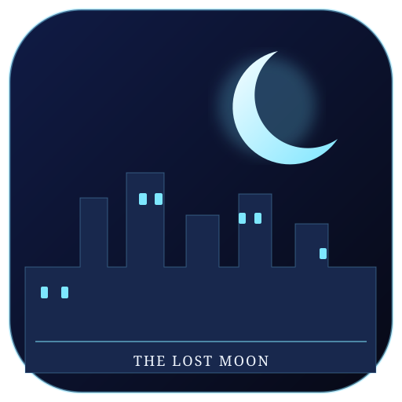

# The City That Forgot the Moon 🌙

A free, offline-friendly, third-person 3D exploration story for Android.

## Chapter 1 — The Letter
Chapter 1 has four simple stages, ordered from easy to hard:

1. **The Quiet Street — Easy:** learn movement and find the first blue memory.
2. **The Forgotten House — Easy–Medium:** uncover a clue about a key.
3. **Strange Footprints — Medium:** follow the trail and collect another memory.
4. **Meet Mira — Hard:** find the last memory and complete the chapter.

### Controls
- Use the touchscreen joystick to walk.
- Tap **INTERACT** near a glowing blue memory.
- Tap **JOURNAL** to review your clues.

## Build the Android APK
1. Open the **Actions** tab in this repository.
2. Select **Build City Moon 3D APK**.
3. Tap **Run workflow** (or wait for the automatic build after a push).
4. Open the completed run and download the `city-moon-3d-debug-apk` artifact.

The workflow creates the Android WebView wrapper and packages the lightweight WebGL game. This is an early playable prototype, not a finished commercial-grade 3D game. Test the APK on your Android device before sharing it.

## Files
- `assets/logo.svg` — project logo
- `chapter-1.json` — Chapter 1 stages, objectives, and clues
- `.github/workflows/build-apk.yml` — Android APK build workflow
